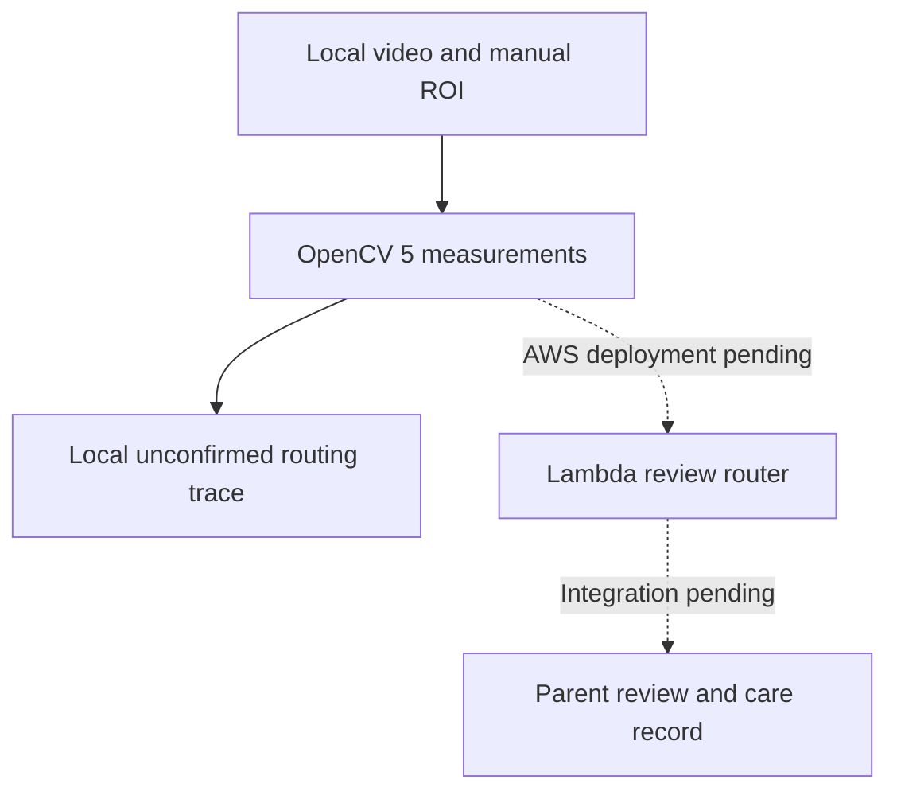

# CARLi — Evidence Before Care

OpenCV AI Competition 2026, powered by AWS. **Technical report draft; not ready for final submission.**

## Problem and intended users

Cat and dog parents cannot continuously observe daily care. A short camera clip may show activity without establishing which baby was present, whether contact occurred, or whether food was ingested. A useful assistant must preserve those distinctions, request better evidence when necessary, and leave consequential interpretation and care actions under human control.

CARLi explores a bounded visual observation input for CAIOS. The immediate prototype measures a manually specified region in a short video and routes the resulting evidence to recapture, human review or continued observation. It does not diagnose, prescribe or confirm feeding.

## Implemented architecture

`run_video.py` decodes a local synthetic or consented clip using OpenCV 5, measures ROI brightness and Laplacian sharpness on every frame, and computes changed-pixel fractions with `motion.py`. It emits measured samples, a video SHA-256, an unconfirmed decision and a routing trace. The decoder streams frames with limits: 50 MiB, 60 seconds, 7200 frames, 1080p, 120 fps.

`vision_cloud.py` is a Lambda-ready, standard-library router. It validates the measurement contract, recomputes the usable-frame fraction, ignores client-supplied action claims, and logs an evidence-hash-correlated routing result. `aws_vision_proof.py` is a live SDK execution collector for an independently deployed and published staging function. It enforces the approved account and assumed-role identity, deployed code digest and numeric version, then validates the invocation result and correlated log.

The cloud handler and SDK-boundary behaviour are locally tested. **No AWS deployment or linked OpenCV invocation has yet been executed for this component.** The supplied CloudFormation template is an unexecuted candidate. The separate historical Amazon AgentCore proof is not treated as proof of this pipeline.

The existing CARLi approval/grant modules remain isolated offline prototypes. This work does not establish a network-connected approval-to-care-record integration.

## OpenCV implementation

Motion counts pixels whose blurred grayscale difference crosses a threshold, then counts frames whose changed-pixel fraction exceeds the configured bound. This detects localized visual change rather than merely changes in whole-ROI mean intensity. It cannot identify an animal, a bowl or eating.

Prototype quality bounds are ROI mean intensity 35–240 and Laplacian variance ≥25; at least 80% of frames must pass. These hand-selected bounds are not calibrated clinical or animal-behaviour criteria. Poor quality takes priority over motion: moving but unusable footage still requests a better video.

Clear moving pixels route to `request_owner_review`; clear static footage routes to `continue_observation`. Every result retains `feeding_confirmed=false` and `mutating_tool_invoked=false`. No motion is not refusal to eat, and ROI entry is not ingestion.

## Evaluation performed

The prior repair executed 154 Python tests, with passing GitHub OpenCV CI and existing Web CI at commit `cb0e249b90b5737cd123220acf4e38a73d997aaf`. The cloud-review extension executed a complete local suite of 166 tests. The extension's remote CI must be read independently after publication.

| Encoded synthetic fixture | Measured quality | Result |
|---|---|---|
| Entirely dark | Insufficient | Request clearer video |
| Gaussian-blurred pattern | Insufficient | Request clearer video |
| Overexposed | Insufficient | Request clearer video |
| Clear then partly dark | Insufficient | Request clearer video |
| Clear moving texture | Sufficient, 19 motion frames | Request owner review |
| Clear static texture | Sufficient, zero motion frames | Continue observation |

These generated geometric clips are software correctness fixtures, not real animal videos, classification accuracy measurements or cloud execution evidence. The suite also exercises altered evidence digests, non-finite measurements, wrong runtime/counts, mismatched cloud responses, Root/wrong-account rejection, changed deployment code, missing correlated logs and unversioned function rejection. SDK tests use botocore Stubber; they do not establish successful AWS API calls.

The receipt verifier was repaired to accept real LF/CRLF unittest summaries and reject zero-test runs, failed summaries and misleading escaped/unrelated success strings. File hashes detect changes but do not provide externally signed attestation.

## AWS state and responsible operation

Two real STS checks on 2026-10-26 returned non-target accounts with Root principals. Both were rejected for deployment/invocation. The current AWS11 target is the separately verified target account with an authorized assumed-role session. No Root fallback or organizational-policy bypass was attempted. No AWS infrastructure was modified.

The candidate Lambda has no public endpoint or pet-state write capability. Its proposed execution role writes only its own logs; the candidate log retention is seven days. The proof runner invokes only a numeric function version in isolated staging and records request/digest linkage. These controls must still be service-validated and reviewed before deployment; a template alone is not a verified security boundary.

## Limitations and remaining work

- Restore correct AWS access, review/deploy staging and collect real dark/moving/static invocation receipts.
- Evaluate labelled, consented cat and dog clips; document false positives and failure cases.
- Implement and verify a usable parent-review surface and confirmed care-record integration.
- Establish judge-accessible running endpoint or arrange a real live screen-share.
- Record an accessible ≤5-minute video showing the team, running app, actual architecture and results.
- Freeze final SHA/archive and complete the OpenCV Devpost fields and submission receipt.

Camera movement, shadows and compression can trigger review. Low-texture but clear video can be rejected conservatively. No pet/bowl/identity/occlusion detector, feeding classifier, medical inference, automatic actuation, COOL, SLAM or Digital Twin is claimed. Agentic Vision remains conditional on a fully demonstrated perception–decision–action/human-review loop; deterministic routing and unit tests alone are not award certification.

## Reproduction and IP boundary

See `OPENCV_REPAIR_ACCEPTANCE.md` and `AWS_REVIEW_EXECUTION.md` for pinned dependencies, tests, local video analysis and gated AWS invocation. Keep real credentials, raw private footage, CAIOS core memory/retrieval internals and unrelated commercial assets outside the submission. Media rights, final legal declarations and judge access must be checked before submission. This isolated extension must not be represented as part of a previously frozen Amazon AppDev or Nebius entry.
